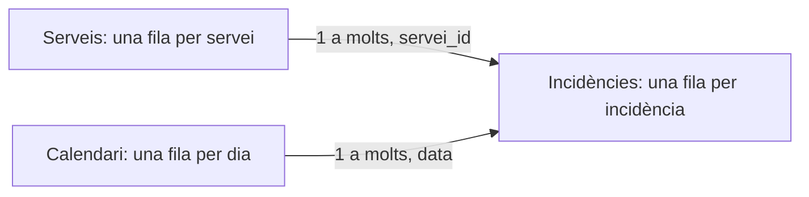

# 10 · Dashboards y modelado con Power BI

[← Índex de les píndoles](../index.md)

!!! abstract "Qué aprenderás"
    - Definir indicadores con numerador y denominador.
    - Relacionar hechos y dimensiones y crear medidas.
    - Verificar filtros, totales y comunicación de resultados.

**Conocimientos previos:** Granularidad, agrupaciones y gráficos; acceso a Power BI Desktop para la parte visual.

**Dedicación orientativa:** 4–5 h para lectura y laboratorio guiado; las extensiones y los ejercicios autónomos requieren tiempo adicional.

!!! tip "Dos recorridos posibles"
    **Esencial:** lee los cimientos, ejecuta el laboratorio y completa la práctica inicial. **Profundización:** continúa con las prácticas intermedia y avance y los ejercicios. El profesorado puede seleccionarlas según los conocimientos previos; no son todas obligatorias dentro del proyecto.

## Mapa de la unidad

Un cuadro de mando empieza con una decisión → Granularidad y modelo de datos → Preparación con Power Query → Columnas calculadas y mesuras → Contexto de filtro → Tiempo, comparaciones y predicciones → Diseño y accesibilidad → Verificación y distribución

## 1. Un cuadro de mando empieza con una decisión

Un dashboard reúne indicadores y filtros para responder preguntas recurrentes. El primer trabajo es determinar quién lo consultará, qué decisión tomará y qué periodicidad necesita. Un informe para explorar causas puede requerir más detalle que una pantalla para detectar incidencias del día.

Escribe tres preguntas antes de elegir gráficos. Por ejemplo: cuántas incidencias tenemos, cuánto de tiempos consumen y qué proporción está resuelta? A continuación, define numerador, denominador, unidad, periodo y fuente de cada indicador.

«Tiempo mediano» es ambiguo si no sabemos si incluye incidencias abiertas, tiempos de espera o solo trabajo activo. Una definición visible evita que dos equipos interpretan la misma tarjeta de manera diferente.

## 2. Granularidad y modelo de datos

La granularidad indica qué representa una fila. En el laboratorio, una fila de `incidencies.csv` representa una incidencia; una fila de `serveis.csv`, un servicio. La primera es una tabla de hechos con medidas y claves; la segunda es una dimensión que describe una entidad.

Un esquema en estrella conecta dimensiones con hechos. La clave del costado «uno» tiene que ser única. Si el catálogo contiene dos filas del mismo servicio, no se tiene que forzar una relación sin entender qué representan.



Una relación no es una fusión física de todas las columnas. Propaga filtros según su dirección y configuración. Para empezar, utiliza dimensiones que filtran hechos en una sola dirección; la bidireccionalidad puede introducir ambigüedad y necesita una razón concreta.

No mezclas ventas mensuales y clientes individuales como si tuvieron la misma granularidad. Una unión mal definida puede multiplicar importes y producir totales aparentemente plausibles.

## 3. Preparación con Power Query

Importa los dos CSV generados por el laboratorio. Revisa el delimitador, la codificación y los tipos antes de cargar. `servei_id`, `id`, `minuts` y `resolt` son enteros; `data` es una fecha; `servei` es texto.

En datos externos, la configuración regional puede afectar fechas y decimales. Una fecha con día y mes intercambiables no es una prueba suficiente: verifica también un valor que no admita las dos lecturas. Conserva los pasos de transformación porque el proceso sea repetible.

Diferencia limpieza de modelado. Corregir espacios en un nombre es una transformación de texto. Decidir si una incidencia abierta entra en una tasa es una definición de negocio. Documenta las dos, pero no escondes la segunda dentro de un filtro poco visible.

Comprueba número de filas, claves únicas, nulos y totales antes y después de una transformación. El laboratorio es pequeño porque se pueda contrastar a mano antes de trabajar con miles de registros.

## 4. Columnas calculadas y medidas

Una columna calculada produce un valor por fila y se conserva en el modelo. Una medida se evalúa cuando se consulta, dentro del contexto de filtros de la visualización. Para totales y tasas interactivas, normalmente necesitamos medidas.

Suponiendo que las mesas importadas se llaman `Incidencies` y `Serveis`, crea cada expresión como una medida independiente:

```dax title="Mesures bàsiques"
Nombre incidencies = COUNTROWS(Incidencies)
```
```dax
Minuts totals = SUM(Incidencies[minuts])
```
```dax
Temps mitja = DIVIDE([Minuts totals], [Nombre incidencies])
```
```dax
Resoltes = SUM(Incidencies[resolt])
```
```dax
Taxa resolucio = DIVIDE([Resoltes], [Nombre incidencies])
```

`resolt` está codificado como 0 o 1; por eso sumarlo equivale a contar las resueltas. Si los datos usan texto o hay valores ausentes, esta equivalencia se tiene que revisar. Formatea la tasa como porcentaje; no multiplicas también por 100 si el formato ya lo hace.

`DIVIDE` permite gestionar denominadores nulos o cero. Una ausencia de datos no siempre significa cero: mostrar un blanco puede ser más honesto que afirmar que la tasa es 0%.

## 5. Contexto de filtro

Una tarjeta sin filtros considera todas las incidencias visibles. Si seleccionamos el servicio Web, las medidas tienen que considerar solo las dos incidencias de ese servicio. La fórmula es la misma; el contexto es diferente.

| Contexto | Incidencias | Minutos totales | Tiempo mediano | Tasa resolución |
|---|---:|---:|---:|---:|
| #El | 4 | 200 | 50 | 75% |
| Web | 2 | 60 | 30 | 50% |
| Corred | 2 | 140 | 70 | 100% |

Una media de medias puede dar un resultado incorrecto cuando los grupos tienen medidas diferentes. Para agregar, conserva numeradores y denominadores y vuelve a calcular la tasa. En este ejemplo los dos grupos tienen igual medida, pero no es una propiedad general.

`CALCULATE` modifica el contexto. Por ejemplo, una medida restringida a Web puede usar `CALCULATE([Nombre incidencies], Serveis[servei] = "Web")`. Hay que probar qué pasa si el lector selecciona Correo: un filtro explícito sobre la misma columna puede sustituir el existente. No introduzcas medidas así sin explicar el efecto esperado.

## 6. Tiempo, comparaciones y predicciones

Una dimensión de calendario con fechas únicas y continuas facilita comparaciones temporales. La comparación «mas anterior» necesita definir si comparamos meses completos o un mes parcial con uno de completo. Una diferencia puede reflejar simplemente más días de observación.

En un dashboard predictivo, separa visualmente observaciones y estimaciones. Muestra fecha de corte, horizonte, unidad y modelo o versión. Una línea continua que une datos reales y predicciones sin leyenda puede hacer creer que todo ha pasado.

Si hay intervalos, explica qué representan y como se han obtenido. Una banda dibujada arbitrariamente alrededor de una predicción no es una estimación de incertidumbre. Si no disponemos de intervalos validados, comunica la limitación.

## 7. Diseño y accesibilidad

Organiza la página según las preguntas. Las tarjetas pueden mostrar volumen, tiempo y tasa; un gráfico de barras permite comparar servicios; una mesa ayuda a comprobar valores. No hay que llenar todos los espacios con visuales.

Usa títulos que explican unidad y periodo, colores consistentes y contraste suficiente. Evita transmitir el estado solo con rojo y verde: añade texto, símbolos o hashtags. Ordena las categorías con un criterio útil y revisa que los filtros activos sean visibles.

Una pantalla tiene que permitir distinguir rápidamente una ausencia de datos, un valor cero y un resultado filtrado. Incluye una nota breve con definiciones y actualización. Prueba el informe como si fuiste una persona que no ha participado en su construcción.

## 8. Verificación y distribución

Antes de compartir, contrasta las cinco medidas con los controles del laboratorio, aplica filtros combinados y vuelve al estado inicial. Revisa también el comportamiento de una selección sin registros.

Power BI Desktop es el entorno previsto para la práctica visual. Los CSV y los controles Python se pueden generar en otros sistemas; la construcción del informe requiere un entorno compatible con Desktop. Las opciones de publicación y compartición dependen del entorno y las licencias del centro: esta píldora no presupone una modalidad concreta.

En esta píldora se han ejecutado el generador de datos y los controles numéricos. Las medidas y las interacciones se tienen que verificar en Power BI Desktop durante la práctica; no se presenta un fichero PBIX ya validado.

## Laboratorio completo y reproducible

**Contexto:** trabajaremos con datos sintéticos creados por el mismo programa. No hay que descargar datasets ni usar los CSV de BiciTierra. Los valores sirven para aprender y comprobar procedimientos; no describen una población real.

**Materiales:** Python 3.10 o superior, un entorno virtual y los [requisits de la unitat](requirements.txt). Consulta la [preparació comuna](../index.md) antes de instalarlos.

Desde la carpeta de esta píldora, con el entorno activado:

```bash
python -m pip install -r requirements.txt
python codi/exemple.py
```

El programa crea `codi/eixides/`. Puedes examinar las salidas sin modificar el código original. Para resolver las variantes, trabaja sobre una copia y actualiza las comprobaciones cuando cambias deliberadamente los datos.

### Ejemplo comentado

[Obri o descarrega el programa complet](codi/exemple.py){ download="exemple.py" }. Cada comprobación `assert` expresa una propiedad esperada de los datos de demostración; si falla, investiga la causa antes de eliminarla.

```python title="codi/exemple.py" linenums="1"
"""Dades menudes d'un servei tècnic i totals per comprovar manualment Power BI."""
from pathlib import Path
import pandas as pd

def main():
    out = Path(__file__).resolve().parent / 'eixides'
    out.mkdir(exist_ok=True)
    # Una fila representa una incidència: esta és la granularitat.
    facts = pd.DataFrame({'id': [1, 2, 3, 4], 'data': ['2026-01-01', '2026-01-02', '2026-02-01', '2026-02-02'], 'servei_id': [1, 1, 2, 2], 'minuts': [20, 40, 60, 80], 'resolt': [1, 0, 1, 1]})
    # El catàleg té una clau única per servei.
    dim = pd.DataFrame({'servei_id': [1, 2], 'servei': ['Web', 'Correu']})
    facts.to_csv(out / 'incidencies.csv', index=False)
    dim.to_csv(out / 'serveis.csv', index=False)
    # Els totals menuts permeten contrastar després el dashboard a mà.
    assert facts.id.nunique() == 4 and facts.minuts.sum() == 200
    print('Controls esperats: 4 incidències; 200 minuts; mitjana 50; resolució 75%.')
    print('Filtre Web: 2 incidències; 60 minuts; mitjana 30; resolució 50%.')
    print('Filtre Correu: 2 incidències; 140 minuts; mitjana 70; resolució 100%.')
if __name__ == '__main__':
    main()
```

## Prácticas guiadas

Cada práctica deja una evidencia pequeña: una salida comprobada y una explicación de la decisión. Los tiempos son orientativos y no incluyen instalación.

### Práctica 1 · Importar y relacionar

**Nivel y tiempo:** Inicial · 20–30 min.

**Objetivo:** Construir un modelo pequeño que se pueda comprobar manualmente.

**Materiales:** ejemplo comentado de esta unidad, sus salidas y una copia de trabajo para las modificaciones.

**Procedimiento:**

1. Ejecuta el generador e importa los dos CSV en Power BI Desktop.
2. Denomina las mesas `Incidencies` y `Serveis` y revisa los tipos de datos.
3. Crea la relación de Servicios a Incidencies por `servei_id`, de uno a muchos y con filtro en una dirección.
4. Muestra en una mesa servicio y número de incidencias y contrasta los recuentos con los CSV.

!!! success "Comprobación y evidencia esperada"
    Hay dos servicios únicos y cuatro incidencias; cada servicio  tiene dos.

**Preguntas de reflexión:**

- Por qué `servei_id` tiene que ser único en la dimensión?
- Qué representa una fila de hechos?
- Qué síntoma podría indicar una relación incorrecta?

**Ampliación opcional:** Introduce deliberadamente una clave de servicio desconocida en una copia de datos y observa como se manifiesta.

### Práctica 2 · Medidas que respetan filtros

**Nivel y tiempo:** Intermedia · 30–45 min.

**Objetivo:** Verificar numeradores, denominadores y contexto.

**Materiales:** ejemplo comentado de esta unidad, sus salidas y una copia de trabajo para las modificaciones.

**Procedimiento:**

1. Crea las cinco medidas DAX de la teoría, una por una.
2. Añade tarjetas con recuento, minutos, media y tasa de resolución.
3. Añade un segmentador de servicio y comprueba sucesivamente Todo, Web y Correo.
4. Registra los resultados en una mesa y compáralos con los nueve valores de recuento, minutos y media y las tres tasas de control.

!!! success "Comprobación y evidencia esperada"
    Los totales son 4, 200, 50 y 75%; los filtres Web y Correo dan exactamente los controles de la teoría.

**Preguntas de reflexión:**

- Por qué la tasa es una medida y no la media de porcentajes ya agregados?
- Qué tendría que mostrar una selección sin datos?
- Qué pasaría si `resolt` contuviera valores diferentes de 0 y 1?

**Ampliación opcional:** Añade un tercer servicio con una sola incidencia y comprueba por qué la media simple de medias deja de ser correcta.

### Práctica 3 · Diseñar una página para tomar decisiones

**Nivel y tiempo:** Avance · 45–60 min.

**Objetivo:** Comunicar indicadores con definiciones y filtros visibles.

**Materiales:** ejemplo comentado de esta unidad, sus salidas y una copia de trabajo para las modificaciones.

**Procedimiento:**

1. Organiza una página con las cuatro tarjetas, barras de minutos por servicio y una tabla de detalle.
2. Añade título, periodo, nota de datos sintéticos y definición del tiempo mesurado.
3. Prueba interacciones seleccionando una barra y después limpiando filtros.
4. Pide a otra persona que responda las tres preguntas iniciales sin explicaciones orales y anota las dudas.

!!! success "Comprobación y evidencia esperada"
    Los controles numéricos continúan pasando y la página permite identificar filtres activos y unidades.

**Preguntas de reflexión:**

- Qué visual aporta una información diferente de las tarjetas?
- Cómo distinguirías datos observados y estimadas en una ampliación?
- Qué mejorarías después de la prueba con otra persona?

**Ampliación opcional:** Añade una página de definiciones y un calendario para una ampliación temporal con más observaciones.

## Ejercicios autónomos

Intenta resolver cada reto antes de desplegar la orientación. Se valora el razonamiento y las comprobaciones, no solo obtener una cifra.

### Reto 1 · Mediana de medias

Un servicio tiene una incidencia de 100 minutos y otro nueve incidencias de 10. Calcula el tiempo mediano global.

??? example "Solución orientativa y criterio de revisión"
    El total es 190 minutos entre 10 incidencias: 19 minutos. Hacer la media de 100 y 10 da 55 y es incorrecto para el conjunto.

### Reto 2 · Tasa con filtro

Diseña una comprobación para detectar que un segmentador no afecta las tarjetas.

??? example "Solución orientativa y criterio de revisión"
    Selecciona un servicio con valores conocidos y contrasta con la tabla de control. Revisa relación, dirección e interacciones visuales antes de modificar fórmulas al azar.

### Reto 3 · Predicción visible

Esboza una visual que combino seis meses observados y dos previstos.

??? example "Solución orientativa y criterio de revisión"
    Diferencia series con estilo y leyenda, marca la fecha de corte e indica horizonte y unidades. Si no hay intervalos validados, no inventas una banda de incertidumbre.

## Errores habituales y diagnóstico

| Síntoma | Causa que conviene investigar | Comprobación o corrección |
|---|---|---|
| Totales multiplicados | Granularidad o relación incorrecta. | Comprueba claves y una mesa pequeña manualmente. |
| Segmentador sin efecto | Relación o interacción no configurada. | Verifica dirección de filtro e interacciones visuales. |
| Tasa multiplicada por ciento dos veces | Fórmula y formato porcentual superpuestos. | Devuelve una proporción y aplica formado porcentaje. |

## Autoevaluación y evidencias

Antes de dar la unidad por trabajada, comprueba estos puntos y escribe una frase de evidencia para cada uno:

- [ ] Puedo definir indicadores con numerador y denominador.
- [ ] Puedo relacionar hechos y dimensiones y crear medidas.
- [ ] Puedo verificar filtros, totales y comunicación de resultados.
- [ ] He ejecutado el laboratorio y he contrastado al menos un resultado independientemente.
- [ ] Puedo explicar una limitación y un caso en que el procedimiento requeriría cambios.

**Entregable de la píldora:** copia de trabajo reproducible, resultados de la práctica seleccionada y un texto breve que indico pregunta, decisión, comprobación y limitación. Si se usa dentro de BiciTierra Market, integra esta evidencia en el entregable semanal correspondiente; no hay que crear una entrega duplicada.

## Fuentes para profundizar

- [Documentació oficial de referència](https://learn.microsoft.com/en-us/power-bi/guidance/star-schema). Consulta especialmente los conceptos y los supuestos descritos en la unidad.
- [Opcions de càlcul en Power BI](https://learn.microsoft.com/en-us/power-bi/transform-model/desktop-calculations-options).

Las versiones ejecutadas y los límites de la comprobación están en el [registre de validació](../VALIDACIO.md). Los ejemplos son originales y los datos son sintéticos.

## Aplicación final a BiciTierra Market

**Momento orientativo:** semana 6. Esta correspondencia ayuda a elegir materiales y no sustituye el documento de trabajo del alumnado.

Presenta indicadores observados, perfiles y predicciones con granularidad clara. Marca el mes de corte y el horizonte de previsión; no sumas datos de clientes y ventas como si representaron la misma unidad. Contrasta totales con los CSV antes de diseñar la pantalla final.

**Transferencia:** identifica qué concepto acabas de practicar, qué dato del proyecto lo exige y que tienes que cambiar respecto del laboratorio. Justifica esa adaptación antes de copiar código.
