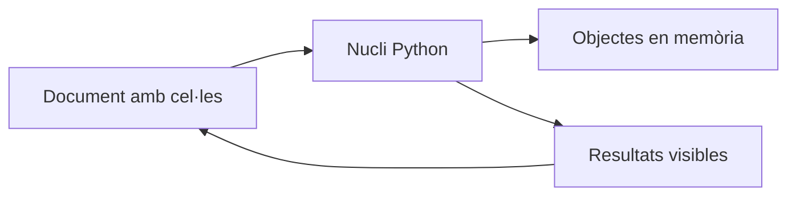

# 02 · Jupyter: notebooks que se pueden reproducir

[← Índex de les píndoles](../index.md)

!!! abstract "Qué aprenderás"
    - Combinar pregunta, código, resultado e interpretación.
    - Detectar dependencias de un estado oculto del núcleo.
    - Ejecutar un notebook completo desde cero.

**Conocimientos previos:** Python básico, listas, funciones y rutas.

**Dedicación orientativa:** 2–3 h para lectura y laboratorio guiado; las extensiones y los ejercicios autónomos requieren tiempo adicional.

!!! tip "Dos recorridos posibles"
    **Esencial:** lee los cimientos, ejecuta el laboratorio y completa la práctica inicial. **Profundización:** continúa con las prácticas intermedia y avance y los ejercicios. El profesorado puede seleccionarlas según los conocimientos previos; no son todas obligatorias dentro del proyecto.

## Mapa de la unidad

Un documento que también se ejecuta → Celdas de código y celdas de texto → La orden visual y la orden real → El intérprete del terminal puede ser diferente → Rutas, datos y salidas → Del experimento a un informe verificable → Lectura crítica y colaboración

## 1. Un documento que también se ejecuta

Un notebook combina texto, código y resultados en una secuencia de celdas. Es útil para investigar una pregunta porque permite documentar hipótesis junto a las operaciones y de las evidencias. Sin embargo, la apariencia de un informe acabado no garantiza que el código se pueda volver a ejecutar.

El fichero `.ipynb` almacena una estructura JSON: celdas, metadatos y, a menudo, salidas anteriores. El **núcleo** o **kernel* es el proceso que ejecuta el lenguaje y mantiene las variables en memoria. La interfaz del navegador es otra pieza. Cerrar una pestaña y reiniciar el núcleo no son la misma operación.



## 2. Celdas de código y celdas de texto

Una celda de código calcula. Una celda Markdown explica la pregunta, el procedimiento o la interpretación. Escribir «aquí basura un groupby» repite el código; explicar «comparamos tiempo por servicio porque el volumen puede ocultar un equipo saturado» documenta el criterio.

Un notebook legible tiene una pregunta inicial, los datos y dependencias, una exploración, unas decisiones y una conclusión. Las salidas se tienen que seleccionar: centenares de filas impresas dificultan encontrar el resultado importante. Muestra resúmenes, casos representativos y recuentos de control.

```python title="Una cel·la amb una evidència menuda"
litres = [110, 125, 100, 140, 125]
mitjana = sum(litres) / len(litres)
print(f"Consum mitjà: {mitjana:.1f} litres/dia")
```

La interpretación es que esta muestra tiene una media de 120 litros. No podemos afirmar que sea el consumo habitual de un año, porque solo tenemos cinco días. Una conclusión correcta incluye el límite del que se ha observado.

## 3. La orden visual y la orden real

Supone que una celda define `factor = 2` y otra calcula `10 * factor`. Si ejecutas la segunda después de haber cambiado el factor a 3 en una celda eliminada, el resultado puede mostrar 30 aunque el documento visible sugiera 20.

Los contadores de ejecución ayudan a detectar saltos, pero no son una prueba completa. La comprobación más útil es reiniciar el núcleo y ejecutar todas las celdas desde arriba. Si falla, hay dependencias ocultas, ficheros no disponibles o una secuencia incorrecta.

!!! warning "Guardar no equivale a reproducir"
    Un resultado antiguo puede continuar visible aunque el código haya cambiado. Después de modificar el procedimiento, vuelve a ejecutar desde un estado limpio antes de interpretar o entregar.

No se resuelve esta situación con más variables globales. Organiza transformaciones en funciones y usa nombres que distingan datos originales, preparadas y resultados. Evita modificar el mismo DataFrame muchas veces sin saber qué versión contiene.

## 4. El intérprete del terminal puede ser diferente

El terminal y el núcleo pueden usar entornos diferentes. La prueba directa dentro del notebook es:

```python title="Identificar el nucli i la carpeta actual"
import sys
from pathlib import Path

print(sys.executable)
print(Path.cwd())
```

Si falta una biblioteca, identifica el núcleo antes de instalarla. La magia `%pip` del entorno IPython está diseñada para operar en el entorno del núcleo, pero también hay que comprobar si se requiere reiniciarlo. Las órdenes que empiezan con `!` ejecutan una orden de sistema; no son Python portátil fuera del notebook.

Para registrar explícitamente un entorno como núcleo, se puede usar `python -m ipykernel install --user --name nom-del-projecte --display-name "Python del projecte"` desde ese entorno. El nombre visible es una ayuda, pero la comprobación definitiva continúa siendo `sys.executable`.

## 5. Rutas, datos y salidas

Un notebook tiene que declarar desde donde lee. Con `Path('../dades')`, la ruta depende del directorio de trabajo y no de una intuición sobre donde está la pestaña. Antes de analizar un CSV, comprueba que existe y que corresponde a la versión esperada.

Una ruta absoluta de la máquina del autor hace el material poco portátil. Una estructura de carpetas compartida y rutas relativas explícitas acostumbran a ser más útiles. Cuando el proyecto crece, añade una configuración clara de la ruta base.

Los gráficos, métricas y exports son salidas derivadas. No sustituyas el fichero original de datos con una transformación de prueba. Separar entradas y resultados permite repetir el análisis y contrastar qué ha cambiado.

## 6. Del experimento a un informe verificable

La reproducción tiene diferentes niveles. Reexecutar sin errores comprueba dependencias básicas. Obtener las mismas métricas también puede requerir fijar entonces y versiones. Obtener una conclusión robusta exige, además, una muestra adecuada y un procedimiento de evaluación coherente.

| Situación | Que se tiene que comprobar |
|---|---|
| `NameError` después de reiniciar | La variable se define en una celda anterior visible? |
| Un importe funciona solo al terminal | Es el mismo intérprete? |
| Resultados diferentes cada vez | Hay aleatoriedad, datos cambiantes o dependencia de estado? |
| Notebook muy lento o enorme | Se imprimen demasiados datos o se repiten cálculos costosos? |
| Un gráfico no concuerda con la mesa | Corresponden a la misma ejecución y a los mismos datos? |

El programa de laboratorio crea un notebook con una pregunta sobre consumo de agua y lo ejecuta con `nbclient`, una biblioteca para la ejecución programática. Esto permite comprobar la secuencia sin hacer clic manualmente. La verificación contiene también un aserto del resultado esperado: ejecutarse no es suficiente si el cálculo es incorrecto.

Un notebook es especialmente adecuado para exploración y explicación. Una tarea programada, un servicio web o un proceso largo suele necesitar funciones y módulos ejecutables. El paso habitual es extraer la lógica estable a un script y conservar el notebook como análisis y documentación.

## 7. Lectura crítica y colaboración

Antes de compartir, revisa si las salidas muestran datos personales, claves o caminos internos. Un fichero de confianza puede contener código que acceda a recursos de la máquina: lee las celdas antes de ejecutar material que no conoces. La marca de confianza de la interfaz no es una auditoría del programa.

En trabajo en equipo, asignar cada persona a una celda puede generar un documento incoherente. Es mejor acordar las entradas, las funciones, los nombres de los datos y una persona que compruebo la ejecución completa. El relato tiene que corresponder al que el código hace, no al que el equipo pretendía hacer.

Una revisión útil puede seguir tres preguntas: qué resultado se quiere demostrar, qué datos lo avalan y que pasaría si se ejecutara todo en una máquina nueva? Estas preguntas son igualmente válidas en un informe de laboratorio, un análisis de servicios o una investigación estadística.

## Laboratorio completo y reproducible

**Contexto:** trabajaremos con datos sintéticos creados por el mismo programa. No hay que descargar datasets ni usar los CSV de BiciTierra. Los valores sirven para aprender y comprobar procedimientos; no describen una población real.

**Materiales:** Python 3.10 o superior, un entorno virtual y los [requisits de la unitat](requirements.txt). Consulta la [preparació comuna](../index.md) antes de instalarlos.

Desde la carpeta de esta píldora, con el entorno activado:

```bash
python -m pip install -r requirements.txt
python codi/exemple.py
```

Para abrir los notebooks generados con la interfaz opcional: `python -m notebook`. Selecciona el núcleo del mismo entorno. El generador ejecuta también una copia desde un núcleo nuevo.

El programa crea `codi/eixides/`. Puedes examinar las salidas sin modificar el código original. Para resolver las variantes, trabaja sobre una copia y actualiza las comprobaciones cuando cambias deliberadamente los datos.

### Ejemplo comentado

[Obri o descarrega el programa complet](codi/exemple.py){ download="exemple.py" }. Cada comprobación `assert` expresa una propiedad esperada de los datos de demostración; si falla, investiga la causa antes de eliminarla.

```python title="codi/exemple.py" linenums="1"
"""Crea un notebook menut i comprova l'execució des d'un nucli nou."""
from pathlib import Path
import nbformat
from nbclient import NotebookClient

def main():
    out = Path(__file__).resolve().parent / 'eixides'
    out.mkdir(exist_ok=True)
    # El notebook conté tant la pregunta com el càlcul i la interpretació.
    nb = nbformat.v4.new_notebook(cells=[nbformat.v4.new_markdown_cell("# Consum d'aigua\nDades sintètiques. Pregunta: quin consum mitjà tenen cinc dies?"), nbformat.v4.new_code_cell("litres = [110, 125, 100, 140, 125]\nassert all(x >= 0 for x in litres)\nprint('Dies:', len(litres))"), nbformat.v4.new_code_cell("mitjana = sum(litres) / len(litres)\nprint('Mitjana:', mitjana)\nassert mitjana == 120"), nbformat.v4.new_markdown_cell("## Interpretació\nLa mitjana és de 120 litres/dia. Cinc dies no permeten estimar l'estacionalitat anual.")])
    nb.metadata['kernelspec'] = {'display_name': 'Python 3', 'language': 'python', 'name': 'python3'}
    nbformat.write(nb, out / 'aigua.ipynb')
    # Un nucli nou evita dependre de variables d’una sessió anterior.
    executed = NotebookClient(nb, timeout=60, kernel_name='python3', resources={'metadata': {'path': str(out)}}).execute()
    nbformat.write(executed, out / 'aigua-executat.ipynb')
    assert all((c.get('execution_count') is not None for c in executed.cells if c.cell_type == 'code'))
    print('Notebook creat i executat des de zero: mitjana 120 litres/dia')
if __name__ == '__main__':
    main()
```

## Prácticas guiadas

Cada práctica deja una evidencia pequeña: una salida comprobada y una explicación de la decisión. Los tiempos son orientativos y no incluyen instalación.

### Práctica 1 · Leer un notebook como un argumento

**Nivel y tiempo:** Inicial · 20–30 min.

**Objetivo:** Relacionar cada celda con una pregunta, un cálculo o una interpretación.

**Materiales:** ejemplo comentado de esta unidad, sus salidas y una copia de trabajo para las modificaciones.

**Procedimiento:**

1. Ejecuta el generador y abre `codi/eixides/aigua.ipynb` en Jupyter.
2. Clasifica las cuatro celdas según su función: contexto, preparación, cálculo y conclusión.
3. Ejecútalas en orden y compara el resultado con `aigua-executat.ipynb`.
4. Añade una celda Markdown con las unidades, la procedencia sintética y la limitación de los cinco días observados.

!!! success "Comprobación y evidencia esperada"
    Las dos celdas de código tienen salida y la media es 120 litros/día; el relato no promete una predicción anual.

**Preguntas de reflexión:**

- Por qué una salida guardada no demuestra que el código actual funciono?
- Qué información aporta Markdown que no aporta un comentario breve?
- Qué conclusión excedería los datos disponibles?

**Ampliación opcional:** Cambia el título porque expreso la pregunta concreta y no solo el nombre de la herramienta.

### Práctica 2 · Hacer visible el estado oculto

**Nivel y tiempo:** Intermedia · 30–45 min.

**Objetivo:** Experimentar con la orden de ejecución y corregir dependencias invisibles.

**Materiales:** ejemplo comentado de esta unidad, sus salidas y una copia de trabajo para las modificaciones.

**Procedimiento:**

1. Fez una copia del notebook y ejecuta todas las celdas una vez.
2. Cambia temporalmente la definición de `litres` a otra lista y ejecuta solo esa celda.
3. Vuelve a mostrar el código original sin ejecutarlo y calcula la media: observa la discrepancia entre texto y estado.
4. Restaura los datos originales, reinicia el núcleo y ejecuta todo en orden. Anota por qué desaparece la discrepancia.

!!! success "Comprobación y evidencia esperada"
    Después de reiniciar y ejecutar todo, el resultado vuelve a 120 y no depende de órdenes de celdas anteriores.

**Preguntas de reflexión:**

- Qué guarda el núcleo entre celdas?
- Por qué un número de ejecución fuera de orden es un indicio, pero no una prueba completa?
- Qué procedimiento harías antes de librar el notebook?

**Ampliación opcional:** Mueve el cálculo antes de la definición de datos en una copia y explica el NameError que aparece en un núcleo limpio.

### Práctica 3 · Convertirlo en un entregable reproducible

**Nivel y tiempo:** Avance · 45–60 min.

**Objetivo:** Añadir controles y una conclusión coherente sin depender de pasos manuales.

**Materiales:** ejemplo comentado de esta unidad, sus salidas y una copia de trabajo para las modificaciones.

**Procedimiento:**

1. Amplía la lista a siete días con 130 y 110 litros y actualiza las comprobaciones esperadas.
2. Añade una celda que calculo mínimo y máximo, y otra con una interpretación breve.
3. Ejecuta desde cero y guarda el notebook con las salidas actualizadas.
4. Intercambia la copia con otra persona o ejecútala con NotebookClient, indicando explícitamente el fichero de la copia.

!!! success "Comprobación y evidencia esperada"
    Hay siete días, media 120, mínimo 100 y máximo 140; las afirmaciones escritas coinciden con el código.

**Preguntas de reflexión:**

- Qué afirmación escrita podría quedar desactualitzada al cambiar datos?
- Cómo distinguirías una celda exploratoria de una parte necesaria?
- Qué dependencia externa dificultaría compartirlo?

**Ampliación opcional:** Añade una comprobación que rechazo valores negativos antes de calcular indicadores.

## Ejercicios autónomos

Intenta resolver cada reto antes de desplegar la orientación. Se valora el razonamiento y las comprobaciones, no solo obtener una cifra.

### Reto 1 · Conclusión dinámica

Evita que una frase con la media quedo desactualitzada al cambiar los datos.

??? example "Solución orientativa y criterio de revisión"
    Puedes imprimir una frase formateada con el valor calculado y reservar Markdown para interpretación y límites. Reinicia y ejecuta todo para comprobar la coherencia.

### Reto 2 · Error intencionado

Introduce una variable sin definir e identifica en qué celda falla la ejecución completa.

??? example "Solución orientativa y criterio de revisión"
    Un núcleo nuevo tiene que producir NameError en la primera referencia. Define explícitamente la variable antes de usarla; ejecutar una celda oculta anterior no es una corrección reproducible.

### Reto 3 · Informe breve

Crea un notebook de seis celdas sobre siete lecturas de temperatura: pregunta, datos, controles, resumen, figura opcional y conclusión.

??? example "Solución orientativa y criterio de revisión"
    Tiene que explicitar unidades y procedencia, comprobar entradas y ejecutarse en orden. No se exige una figura si no responde una pregunta; sí una conclusión que no extrapole una semana a todo el año.

## Errores habituales y diagnóstico

| Síntoma | Causa que conviene investigar | Comprobación o corrección |
|---|---|---|
| Funciona solo después de tocar celdas | Sido oculto del núcleo. | Reinicia y ejecuta todo; ordena las dependencias. |
| Paquete disponible fuera del notebook | Núcleo asociado a otro entorno. | Compara sys.ejecutable y selecciona el núcleo correcto. |
| Texto y salidas no coinciden | Resultados guardados desactualitzats. | Ejecuta desde cero y revisa también las conclusiones escritas. |

## Autoevaluación y evidencias

Antes de dar la unidad por trabajada, comprueba estos puntos y escribe una frase de evidencia para cada uno:

- [ ] Puedo combinar pregunta, código, resultado e interpretación.
- [ ] Puedo detectar dependencias de un estado oculto del núcleo.
- [ ] Puedo ejecutar un notebook completo desde cero.
- [ ] He ejecutado el laboratorio y he contrastado al menos un resultado independientemente.
- [ ] Puedo explicar una limitación y un caso en que el procedimiento requeriría cambios.

**Entregable de la píldora:** copia de trabajo reproducible, resultados de la práctica seleccionada y un texto breve que indico pregunta, decisión, comprobación y limitación. Si se usa dentro de BiciTierra Market, integra esta evidencia en el entregable semanal correspondiente; no hay que crear una entrega duplicada.

## Fuentes para profundizar

- [Documentació oficial de referència](https://jupyter-notebook.readthedocs.io/en/stable/notebook.html). Consulta especialmente los conceptos y los supuestos descritos en la unidad.

Las versiones ejecutadas y los límites de la comprobación están en el [registre de validació](../VALIDACIO.md). Los ejemplos son originales y los datos son sintéticos.

## Aplicación final a BiciTierra Market

**Momento orientativo:** semana 1. Esta correspondencia ayuda a elegir materiales y no sustituye el documento de trabajo del alumnado.

Aplica la secuencia pregunta → datos → controles → cálculo → interpretación a los notebooks del proyecto. Antes de cada entrega, reinicia el núcleo y ejecuta todo. Mantén las decisiones del equipo junto al resultado que las justifica.

**Transferencia:** identifica qué concepto acabas de practicar, qué dato del proyecto lo exige y que tienes que cambiar respecto del laboratorio. Justifica esa adaptación antes de copiar código.
