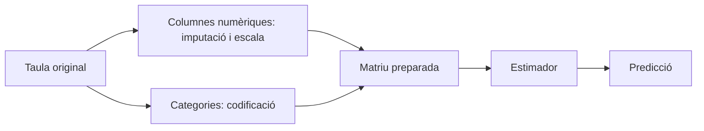

# 06 · Aprendizaje supervisado con scikit-learn

[← Índex de les píndoles](../index.md)

!!! abstract "Qué aprenderás"
    - Separar predictores y objetivo.
    - Comparar una referencia simple con modelos dentro de un pipeline.
    - Reservar la prueba y gestionar entradas nuevas.

**Conocimientos previos:** pandas, funciones y nociones de media y error.

**Dedicación orientativa:** 4–5 h para lectura y laboratorio guiado; las extensiones y los ejercicios autónomos requieren tiempo adicional.

!!! tip "Dos recorridos posibles"
    **Esencial:** lee los cimientos, ejecuta el laboratorio y completa la práctica inicial. **Profundización:** continúa con las prácticas intermedia y avance y los ejercicios. El profesorado puede seleccionarlas según los conocimientos previos; no son todas obligatorias dentro del proyecto.

## Mapa de la unidad

Qué aprende un modelo → El contrato del estimador → Separar antes de preparar → Datos numéricos y categóricas → Pipeline y ColumnTransformer → Referencias, modelos lineales y árboles → Métricas y decisiones → Leer el laboratorio

## 1. Qué aprende un modelo

En aprendizaje supervisado tenemos ejemplos con predictores `X` y un resultado `y`. El modelo ajusta una relación para producir predicciones sobre observaciones nuevas. Ajustar no es memorizar una fórmula científica de la realidad: el resultado depende de la muestra, las variables, el criterio de error y las restricciones del modelo.

La regresión estima una cantidad, como tiempo de resolución o consumo. La clasificación estima una clase, como una categoría de incidencia. Una probabilidad de clase, un hashtag y una cantidad continua requieren métricas e interpretaciones diferentes.

Scikit-learn ofrece una interfaz común para transformar datos, ajustar estimadores y evaluarlos. La biblioteca no decide por nosotros si las observaciones son independientes, si la variable era conocida o si la pregunta de negocio tiene sentido.

## 2. El contrato del estimador

`fit(X, y)` ajusta el modelo. `predict(X_nou)` calcula resultados con aquello que ya ha aprendido. Un transformador también puede ofrecer `transform`; `fit_transform` combina aprender una regla y aplicarla sobre los datos de ajuste.

```python title="Una regressió mínima i les seues dimensions"
import numpy as np
from sklearn.linear_model import LinearRegression

X = np.array([[1.], [2.], [3.], [4.]])
y = np.array([3., 5., 7., 9.])
model = LinearRegression().fit(X, y)
print(model.predict(np.array([[5.]])))  # Aproximadament 11.
```

`X` tiene filas de observaciones y columnas de predictores. `y` tiene que corresponder a las mismas filas. Este ejemplo demuestra el APIO, no valida un sistema predictivo: cuatro puntos perfectamente lineales no representan la variabilidad de un problema real.

## 3. Separar antes de preparar

Hay que reservar datos antes de elegir variables, imputaciones o modelos orientados a predicción. Entrenamiento sirve para ajustar; validación, para decidir; prueba, para estimar el resultado final una vez fijadas las decisiones.

El laboratorio usa viviendas sintéticas generadas independientemente. Por eso una partición aleatoria es coherente con su diseño. Si varias filas corresponden a una misma persona, edificio o periodo, se tiene que considerar una separación por grupos o tiempos. Copiar `train_test_split` sin revisar la unidad de observación es un error metodológico.

No se tiene que ajustar la mediana de imputación sobre todo el dataset. Las transformaciones aprenden propiedades de los datos; también pueden introducir fuga de información. La guía oficial de [problemes habituals](https://scikit-learn.org/stable/common_pitfalls.html) muestra como los pipelines ayudan a mantener esta separación.

## 4. Datos numéricos y categóricas

Una variable numérica puede requerir imputación y escala. Una categoría no se convierte necesariamente en una magnitud asignándole 0, 1 y 2: el modelo podría interpretar una distancia u orden inexistentes.

`OneHotEncoder` crea indicadores por categoría. `handle_unknown='ignore'` permite procesar categorías no vistas sin interrumpir la predicción, pero no significa que el modelo las entienda. La representación resultante puede ser ambigua respecto de categorías conocidas y se tiene que monitorizar.

`StandardScaler` centra y escala con estadísticos de entrenamiento. Es relevante en regularización y distancias; muchos árboles no necesitan la escala para hacer particiones. Utilizar el mismo preprocessament en una comparación didáctica puede simplificarla, pero conviene explicar qué parte necesita cada modelo.

## 5. Pipeline y ColumnTransformer

Un `Pipeline` encadena pasos: preparación seguida de estimador. Cuando el modelo se valida en varias particiones, cada ajuste aprende las transformaciones sobre la parte de entrenamiento correspondiente. Un `ColumnTransformer` aplica operaciones distintas a grupos de columnas.



Guardar solo los coeficientes finales y olvidar la preparación rompe el contrato de inferencia. La misma fila tiene que transformarse con las mismas reglas durante entrenamiento y uso posterior.

## 6. Referencias, modelos lineales y árboles

Un modelo constando, como la media, es una baseline útil: indica qué se consigue sin aprovechar predictores. Un modelo que no mejora la referencia puede necesitar mejores datos, una pregunta diferente o una revisión del procedimiento.

Ridge es una regresión lineal con penalización sobre la medida de los coeficientes. El parámetro `alpha` controla la fuerza de la regularización. Penalizar puede reducir varianza y estabilizar coeficientes, pero demasiada penalización también puede impedir capturar relaciones útiles.

Un árbol parte el espacio de variables según reglas. Un bosque aleatorio combina muchos árboles para reducir dependencia de una única partición. `min_samples_leaf` limita hojas demasiado pequeñas. El modelo puede captar interacciones, pero esto no garantiza una mejora sobre una relación aproximadamente lineal.

## 7. Métricas y decisiones

MAE expresa error absoluto mediano en la unidad del resultado. RMSE penaliza más los errores grandes. R² compara con una referencia basada en la media del conjunto evaluado y puede ser negativo. Ninguna métrica es un certificado universal de calidad.

En clasificación, distingue precisión, sensibilidad y F1; en clases descompensadas, la exactitud puede resultar engañosa. No trasladas ROC/AUC o una matriz de confusión a un problema de unidades continuas sin haber definido una clasificación real.

Compara sobre las mismas filas y con criterios fijados antes. Si eliges el modelo con la prueba y después citas esa métrica como independiente, estás reutilizando el examen para estudiar.

## 8. Leer el laboratorio

El programa genera consumo a partir de superficie, aislamiento y ruido. Introduce ausencias en superficie, compara una referencia, ridge y bosque, elige en validación y evalúa la decisión en prueba. También envía una categoría nueva para observar el comportamiento del codificador.

La pregunta final no es «qué algoritmo gana siempre?», sino «que nos permite afirmar esta comparación?». Los datos son sintéticos, la relación de partida es simple y el resultado no identifica la mejor tecnología para cualquier problema energético.

Para ampliar, exporta la tabla de experimentos y estudia estabilidad con otras muestras de entrenamiento, sin cambiar continuamente la maceta. Registra también tiempo, variables y decisiones; una mejora mínima puede no justificar un mantenimiento mucho más complejo.

## Laboratorio completo y reproducible

**Contexto:** trabajaremos con datos sintéticos creados por el mismo programa. No hay que descargar datasets ni usar los CSV de BiciTierra. Los valores sirven para aprender y comprobar procedimientos; no describen una población real.

**Materiales:** Python 3.10 o superior, un entorno virtual y los [requisits de la unitat](requirements.txt). Consulta la [preparació comuna](../index.md) antes de instalarlos.

Desde la carpeta de esta píldora, con el entorno activado:

```bash
python -m pip install -r requirements.txt
python codi/exemple.py
```

El programa crea `codi/eixides/`. Puedes examinar las salidas sin modificar el código original. Para resolver las variantes, trabaja sobre una copia y actualiza las comprobaciones cuando cambias deliberadamente los datos.

### Ejemplo comentado

[Obri o descarrega el programa complet](codi/exemple.py){ download="exemple.py" }. Cada comprobación `assert` expresa una propiedad esperada de los datos de demostración; si falla, investiga la causa antes de eliminarla.

```python title="codi/exemple.py" linenums="1"
"""Regressió sobre observacions independents sintètiques, no una sèrie temporal."""
from pathlib import Path
import numpy as np
import pandas as pd
from sklearn.compose import ColumnTransformer
from sklearn.impute import SimpleImputer
from sklearn.preprocessing import OneHotEncoder, StandardScaler
from sklearn.pipeline import Pipeline
from sklearn.linear_model import Ridge
from sklearn.ensemble import RandomForestRegressor
from sklearn.dummy import DummyRegressor
from sklearn.model_selection import train_test_split
from sklearn.metrics import mean_absolute_error

def main():
    rng = np.random.default_rng(12)
    X = pd.DataFrame({'superficie': rng.uniform(40, 180, 480), 'aillament': rng.choice(['baix', 'alt'], 480)})
    y = 12 + 0.4 * X.superficie + 18 * (X.aillament == 'baix') + rng.normal(0, 5, len(X))
    X.loc[rng.choice(len(X), 20, replace=False), 'superficie'] = np.nan
    (train, test, yt, ytest) = train_test_split(X, y, test_size=0.2, random_state=42)
    (train, valid, yt, yv) = train_test_split(train, yt, test_size=0.25, random_state=42)

    def make(estimator):
        # La imputació i l’escala s’ajusten dins del pipeline, només amb entrenament.
        numeric = Pipeline([('impute', SimpleImputer(strategy='median')), ('scale', StandardScaler())])
        prep = ColumnTransformer([('num', numeric, ['superficie']), ('cat', OneHotEncoder(handle_unknown='ignore', sparse_output=False), ['aillament'])])
        return Pipeline([('prep', prep), ('model', estimator)])
    candidates = {'dummy': make(DummyRegressor()), 'ridge': make(Ridge(alpha=1)), 'forest': make(RandomForestRegressor(n_estimators=80, min_samples_leaf=5, random_state=42, n_jobs=1))}
    metrics = {}
    for (name, model) in candidates.items():
        model.fit(train, yt)
        metrics[name] = mean_absolute_error(yv, model.predict(valid))
    # La selecció usa exclusivament validació; la prova es consulta després.
    chosen = min(metrics, key=metrics.get)
    print('MAE validació:', metrics)
    print('Triat:', chosen)
    print('MAE test reservat:', mean_absolute_error(ytest, candidates[chosen].predict(test)))
    assert min(metrics.values()) < metrics['dummy']
    out = Path(__file__).resolve().parent / 'eixides'
    out.mkdir(exist_ok=True)
    pd.DataFrame({'real': ytest, 'prediccio': candidates[chosen].predict(test)}).to_csv(out / 'prova.csv', index=False)
    print('Categoria nova:', candidates[chosen].predict(pd.DataFrame({'superficie': [85.0], 'aillament': ['mitja']})))
if __name__ == '__main__':
    main()
```

## Prácticas guiadas

Cada práctica deja una evidencia pequeña: una salida comprobada y una explicación de la decisión. Los tiempos son orientativos y no incluyen instalación.

### Práctica 1 · Entender el contrato de predicción

**Nivel y tiempo:** Inicial · 20–30 min.

**Objetivo:** Identificar objetivo, predictores y particiones antes de ajustar.

**Materiales:** ejemplo comentado de esta unidad, sus salidas y una copia de trabajo para las modificaciones.

**Procedimiento:**

1. Ejecuta el laboratorio y localiza las 480 observaciones sintéticas.
2. Calcula las medidas de las particiones después de los dos repartos: entrenamiento, validación y prueba.
3. Dibuja el recorrido desde las columnas originales hasta la predicción del pipeline.
4. Explica por qué el reparto aleatorio es aceptable en esta simulación independiente, pero no se traslada automáticamente a una serie temporal.

!!! success "Comprobación y evidencia esperada"
    Identificas 288, 96 y 96 filas y distingues superficie y aislamiento de la respuesta.

**Preguntas de reflexión:**

- Qué aprendería el DummyRegressor?
- Qué información tendría que estar disponible cuando pedimos una predicción?
- Por qué la respuesta no puede entrar en el preprocessament de predictores?

**Ampliación opcional:** Calcula la distribución de categorías en cada partición sin usarla para retocar la prueba.

### Práctica 2 · Comparar con una referencia

**Nivel y tiempo:** Intermedia · 30–45 min.

**Objetivo:** Seleccionar una alternativa según validación y documentar la decisión.

**Materiales:** ejemplo comentado de esta unidad, sus salidas y una copia de trabajo para las modificaciones.

**Procedimiento:**

1. Registra el MAE de dummy, Ridge y bosque sobre validación.
2. Relaciona cada modelo con una hipótesis sobre la forma de la relación entre entradas y respuesta.
3. Elige según el criterio declarado por el programa y compara la mejora respecto de dummy en unidades de consumo.
4. Consulta la prueba una vez y redacta una conclusión que distinga selección y estimación final.

!!! success "Comprobación y evidencia esperada"
    La mesa conserva los tres candidatos; el modelo seleccionado mejora dummy en este ejemplo, sin generalizar que siempre lo hará.

**Preguntas de reflexión:**

- Por qué ganar en entrenamiento no basta?
- Qué diferencia entre dos MAE sería relevante en el uso previsto?
- Qué harías si todos los modelos empeoraron la referencia?

**Ampliación opcional:** En una nueva exploración con una nueva reserva de prueba, compara dos valores de alpha y registra las decisiones previamente.

### Práctica 3 · Entradas incompletas o desconocidas

**Nivel y tiempo:** Avance · 45–60 min.

**Objetivo:** Comprobar el comportamiento del pipeline ante casos de uso.

**Materiales:** ejemplo comentado de esta unidad, sus salidas y una copia de trabajo para las modificaciones.

**Procedimiento:**

1. Localiza los valores ausentes de superficie y la imputación dentro del pipeline.
2. Predice para una superficie ausente con aislamiento conocido.
3. Examina el caso `aillament="mitja"` que no aparece en entrenamiento y el efecto de `handle_unknown="ignore"`.
4. Propone un control de entrada que avise de categorías nuevas y un procedimiento para decidir si hay que incorporarlas a los datos.

!!! success "Comprobación y evidencia esperada"
    El código puede producir una cifra, pero el informe diferencia compatibilidad técnica de evidencia suficiente para confiar.

**Preguntas de reflexión:**

- Con qué filas se ha ajustado la mediana?
- Por qué ignorar una categoría nueva no equivale a haberla aprendido?
- Qué cambio de población podría invalidar el modelo?

**Ampliación opcional:** Define límites plausibles de superficie y prueba un caso fuera del dominio sin presentarlo como una predicción fiable.

## Ejercicios autónomos

Intenta resolver cada reto antes de desplegar la orientación. Se valora el razonamiento y las comprobaciones, no solo obtener una cifra.

### Reto 1 · Una nueva referencia

Compara DummyRegressor con media y mediana sobre la misma validación.

??? example "Solución orientativa y criterio de revisión"
    Con MAE, la mediana es una referencia natural. Compara datos y partición idénticas; no mujeres por hecho que la ventaja teórica sobre entrenamiento implico una diferencia grande en validación.

### Reto 2 · Clasificación

Reformula un problema como predecir si una incidencia superará un plazo conocido y define objetivo y predictores disponibles.

??? example "Solución orientativa y criterio de revisión"
    El hashtag se calcula después de conocer el desenlace; las entradas tienen que ser las disponibles al abrir la incidencia. No usas duración final ni fecha de resolución como predictores.

### Reto 3 · Fuga sutil

Explica por qué calcular la mediana sobre todas las filas antes de repartirlas es problemático.

??? example "Solución orientativa y criterio de revisión"
    El preprocessament utiliza información de validación y prueba. Ajusta la mediana solo con entrenamiento dentro del pipeline y aplica esa misma transformación a los otros bloques.

## Errores habituales y diagnóstico

| Síntoma | Causa que conviene investigar | Comprobación o corrección |
|---|---|---|
| Validación sorprendentemente perfecta | Posible fuga o duplicados entre bloques. | Audita variables y partición antes de celebrar la métrica. |
| Predicción incompatible con las columnas | Preprocessament separado del modelo. | Usa un pipeline y un esquema de entrada explícito. |
| Categoría nueva sin error pero poco fiable | Codificación que ignora desconocidas. | Registra el caso y revisa cobertura de entrenamiento. |

## Autoevaluación y evidencias

Antes de dar la unidad por trabajada, comprueba estos puntos y escribe una frase de evidencia para cada uno:

- [ ] Puedo separar predictores y objetivo.
- [ ] Puedo comparar una referencia simple con modelos dentro de un pipeline.
- [ ] Puedo reservar la prueba y gestionar entradas nuevas.
- [ ] He ejecutado el laboratorio y he contrastado al menos un resultado independientemente.
- [ ] Puedo explicar una limitación y un caso en que el procedimiento requeriría cambios.

**Entregable de la píldora:** copia de trabajo reproducible, resultados de la práctica seleccionada y un texto breve que indico pregunta, decisión, comprobación y limitación. Si se usa dentro de BiciTierra Market, integra esta evidencia en el entregable semanal correspondiente; no hay que crear una entrega duplicada.

## Fuentes para profundizar

- [Documentació oficial de referència](https://scikit-learn.org/stable/common_pitfalls.html). Consulta especialmente los conceptos y los supuestos descritos en la unidad.

Las versiones ejecutadas y los límites de la comprobación están en el [registre de validació](../VALIDACIO.md). Los ejemplos son originales y los datos son sintéticos.

## Aplicación final a BiciTierra Market

**Momento orientativo:** semana 3. Esta correspondencia ayuda a elegir materiales y no sustituye el documento de trabajo del alumnado.

Construye una referencia de predicción de ventas y un pipeline ajustado solo con el pasado disponible. El reparto aleatorio del laboratorio de viviendas no es el diseño adecuado para trasladarlo sin cambios al histórico mensual; usa la píldora de validación temporal.

**Transferencia:** identifica qué concepto acabas de practicar, qué dato del proyecto lo exige y que tienes que cambiar respecto del laboratorio. Justifica esa adaptación antes de copiar código.
