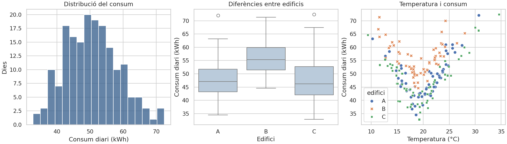

# 05 · Visualización con Matplotlib y seaborn

[← Índex de les píndoles](../index.md)

!!! abstract "Qué aprenderás"
    - Elegir gráficos según la pregunta.
    - Representar distribuciones, relaciones y grupos con unidades.
    - Distinguir dispersión, estimación e incertidumbre.

**Conocimientos previos:** Mesas pandas y estadística descriptiva elemental.

**Dedicación orientativa:** 3–4 h para lectura y laboratorio guiado; las extensiones y los ejercicios autónomos requieren tiempo adicional.

!!! tip "Dos recorridos posibles"
    **Esencial:** lee los cimientos, ejecuta el laboratorio y completa la práctica inicial. **Profundización:** continúa con las prácticas intermedia y avance y los ejercicios. El profesorado puede seleccionarlas según los conocimientos previos; no son todas obligatorias dentro del proyecto.

## Mapa de la unidad

La pregunta precede el gráfico → Figuro, Axes y semántica → Elegir una representación → Que está calculando Seaborn? → Escalas, color y comparaciones justas → Asociación, correlación y causalidad → Exportación y verificación → Escribir una interpretación útil

## 1. La pregunta precede el gráfico

Visualizar significa representar datos porque una relación sea legible. Antes de dibujar hay que decidir qué pregunta se quiere responder, cuál es la unidad de observación y qué comparación tiene sentido. Un gráfico de consumo total puede identificar el edificio más grande; uno de consumo por metro cuadrado responde otra pregunta.

Matplotlib proporciona control sobre figuras, ejes y elementos. Seaborn incorpora funciones orientadas a datos tabulares y a representaciones estadísticas. Seaborn se construye sobre Matplotlib, de forma que se pueden combinar: crear ejes con Matplotlib, dibujar con Seaborn y ajustar títulos, límites o anotaciones.

Un mismo conjunto de datos puede necesitar varias vistas, pero añadir gráficos sin una pregunta distinta aumenta el trabajo de lectura sin aportar evidencia. La selección forma parte del análisis.

## 2. Figuro, Axes y semántica

La `Figure` es el contenedor global y cada `Axes` es una zona donde se dibujan datos. La interfaz orientada a objetos hace explícito donde se aplica cada operación y evita modificar por accidente «el eje actual» en informes con varias vistas.

```python title="Una figura amb una pregunta concreta"
import matplotlib.pyplot as plt

fig, ax = plt.subplots(figsize=(6, 3))
ax.bar(["Web", "Correu", "VPN"], [12, 18, 7])
ax.set(title="Incidències registrades per servei",
       xlabel="Servei", ylabel="Nombre d’incidències")
fig.tight_layout()
plt.close(fig)
```

En Seaborn, `x` y `y` asignan variables a los ejes, `hue` a color y `style` a formas o trazo. No todas las funciones aceptan las mismas opciones. Las funciones de eje, como `scatterplot`, se pueden situar en un `ax`; otros, como `relplot`, crean una figura con su propia estructura.

## 3. Elegir una representación

| Pregunta | Representación habitual | Qué hay que vigilar |
|---|---|---|
| Cómo se distribuye una magnitud? | Histograma o ECDF | Número de intervalos, muestra y valores ausentes |
| Cómo se comparan distribuciones? | Boxplot, violinplot o puntos | Medida de grupo y extremos |
| Cambia una variable con otra? | Dispersión | Solapamiento, no linealidad y confusors |
| Cómo evoluciona en el tiempo? | Línea | Fechas ordenadas y vacíos reales |
| Cómo se comparan totales? | Barras sobre datos agregados | No confundir total, media y frecuencia |
| Qué relaciones hay entre muchas variables? | Matriz de correlación | Asociación lineal, nulos y redundancia |

Un histograma depende de los intervalos; una ECDF muestra la proporción acumulada sin escoger anchura de intervalo. Un boxplot resume cuartiles y puntos según una regla, pero esconde detalles de la forma. En muestras pequeñas, mostrar los puntos puede ser más honesto que una densidad suavizada.

## 4. Qué está calculando Seaborn?

Algunas funciones agregan por defecto. Si `barplot` recibe varias filas de una categoría, su altura acostumbra a representar un estimador, no un recuento ni una suma. `countplot` cuenta observaciones. Si quieres ingresos totales, agrega explícitamente y después representa el resultado.

```python title="Agregació explícita abans de dibuixar"
import pandas as pd
import seaborn as sns
import matplotlib.pyplot as plt

df = pd.DataFrame({"servei":["web","web","vpn"],"minuts":[20,40,10]})
totals = df.groupby("servei", as_index=False)["minuts"].sum()
fig, ax = plt.subplots()
sns.barplot(data=totals, x="servei", y="minuts", errorbar=None, ax=ax)
ax.set_ylabel("Minuts totals registrats")
plt.close(fig)
```

Una barra de error puede representar dispersión de datos o incertidumbre de un estimador; no son equivalentes. Hay que leer el parámetro y explicar qué se está mostrando. Con datos temporales correlacionados, un procedimiento que trata todas las filas como independientes puede dar una impresión de incertidumbre demasiada baja. La documentación de [barres d’error de Seaborn](https://seaborn.pydata.org/tutorial/error_bars.html) distingue estas opciones.

## 5. Escalas, color y comparaciones justas

En barras, empezar lejos de cero puede exagerar diferencias de longitud. En líneas, un rango recortado puede ser útil para ver cambios pequeños si se indica con claridad. No es una prohibición universal: el importante es que la representación no sugiera una magnitud incorrecta.

Una escala logarítmica representa proporciones y facilita leer órdenes de magnitud, pero no admite directamente cero o negativos. Explica la transformación y no lo aplicas solo porque «queda mejor». En varios paneles, usa límites comparables si se pretende comparar magnitudes.

Para categorías, usa colores diferenciables; para cantidades ordenadas, una escala con progresión perceptiva. Añade formas, hashtags o patrones cuando la información no tenga que depender solo del color. Los títulos, unidades y leyendas tienen que permitir interpretar el gráfico fuera del notebook.

## 6. Asociación, correlación y causalidad

Una dispersión revela patrones que una correlación puede ocultar. En el laboratorio, el consumo sube cuando la temperatura se aleja de un punto moderado: la relación no es una recta. La correlación lineal sola puede resumirla mal.

También hay diferencias entre edificios. Si se ignoran, se puede atribuir a temperatura aquello que está relacionado con medida o uso del edificio. Dividir por grupos, mostrar distribuciones y revisar denominadores ayuda a formular preguntas, pero no transforma un estudio observacional en un experimento causal.

Una línea de regresión es una descripción de un modelo, no una demostración que modificar el eje X produzca el cambio representado en Y. Escribe conclusiones como «en esta muestra observamos» y especifica las variables no controladas.

## 7. Exportación y verificación

PNG es práctico para imágenes; SVG conserva elementos vectoriales adecuados para ampliarlos. Un gráfico con muchos puntos puede generar un SVG muy pesado. Elige según el uso, la medida y la necesidad de edición.

Guarda con una resolución adecuada, comprueba el fichero fuera del notebook y cierra figuras cuando generas informes repetidos. Revisa textos cortados, contraste y unidades. Una figura sin errores de código puede continuar siendo imposible de leer.

El laboratorio produce tres vistas sobre 180 días sintéticos de consumo: distribución, comparación por edificio y relación con temperatura. Cada vista responde una pregunta distinta. Los CSV y las figuras se generan localmente, sin descargas.

## 8. Escribir una interpretación útil

Para cada figura, escribe qué representa, qué patrón se observa, qué comprobación lo sustenta y qué conclusión no se puede extraer. Por ejemplo, una media superior en un edificio puede justificar una auditoría, pero no permite afirmar una ineficiencia sin conocer superficie y ocupación.

Una buena revisión gráfica contrasta el dibujo con los totales originales. Si una categoría desaparece, comprueba nulos, filtros y agrupaciones antes de atribuirlo a un fenómeno real.

## Laboratorio completo y reproducible

**Contexto:** trabajaremos con datos sintéticos creados por el mismo programa. No hay que descargar datasets ni usar los CSV de BiciTierra. Los valores sirven para aprender y comprobar procedimientos; no describen una población real.

**Materiales:** Python 3.10 o superior, un entorno virtual y los [requisits de la unitat](requirements.txt). Consulta la [preparació comuna](../index.md) antes de instalarlos.

Desde la carpeta de esta píldora, con el entorno activado:

```bash
python -m pip install -r requirements.txt
python codi/exemple.py
```

El programa crea `codi/eixides/`. Puedes examinar las salidas sin modificar el código original. Para resolver las variantes, trabaja sobre una copia y actualiza las comprobaciones cuando cambias deliberadamente los datos.

### Ejemplo comentado

[Obri o descarrega el programa complet](codi/exemple.py){ download="exemple.py" }. Cada comprobación `assert` expresa una propiedad esperada de los datos de demostración; si falla, investiga la causa antes de eliminarla.

```python title="codi/exemple.py" linenums="1"
"""Informe gràfic local; no descarrega datasets."""
from pathlib import Path
import numpy as np
import pandas as pd
import matplotlib
matplotlib.use('Agg')
import matplotlib.pyplot as plt
import seaborn as sns

def main():
    # La llavor fixa fa repetible esta simulació docent.
    rng = np.random.default_rng(42)
    df = pd.DataFrame({'temperatura': rng.normal(20, 5, 180), 'edifici': np.repeat(['A', 'B', 'C'], 60)})
    df['kwh'] = 40 + 2.5 * abs(df.temperatura - 19) + df.edifici.map({'A': 0, 'B': 8, 'C': -3}) + rng.normal(0, 3, len(df))
    sns.set_theme(style='whitegrid')
    (fig, axes) = plt.subplots(1, 3, figsize=(14, 4), layout='constrained')
    sns.histplot(data=df, x='kwh', bins=18, ax=axes[0], color='#315b8a')
    sns.boxplot(data=df, x='edifici', y='kwh', ax=axes[1], color='#b5cbe0')
    sns.scatterplot(data=df, x='temperatura', y='kwh', hue='edifici', style='edifici', ax=axes[2])
    axes[0].set(xlabel='Consum diari (kWh)', ylabel='Dies', title='Distribució del consum')
    axes[1].set(xlabel='Edifici', ylabel='Consum diari (kWh)', title='Diferències entre edificis')
    axes[2].set(xlabel='Temperatura (°C)', ylabel='Consum diari (kWh)', title='Temperatura i consum')
    out = Path(__file__).resolve().parent / 'eixides'
    out.mkdir(exist_ok=True)
    # Exportem abans de tancar per conservar tots els elements de la figura.
    fig.savefig(out / 'energia.png', dpi=140)
    # Exportem abans de tancar per conservar tots els elements de la figura.
    fig.savefig(out / 'energia.svg')
    plt.close(fig)
    df.to_csv(out / 'energia.csv', index=False)
    assert (out / 'energia.png').stat().st_size > 1000
    print(df.groupby('edifici').kwh.agg(['count', 'mean', 'median']).round(2).to_string())
if __name__ == '__main__':
    main()
```



Figura generada por el programa: datos sintéticos, 60 observaciones por edificio.*

## Prácticas guiadas

Cada práctica deja una evidencia pequeña: una salida comprobada y una explicación de la decisión. Los tiempos son orientativos y no incluyen instalación.

### Práctica 1 · Tres preguntas, tres gráficos

**Nivel y tiempo:** Inicial · 20–30 min.

**Objetivo:** Identificar qué muestra cada representación del laboratorio.

**Materiales:** ejemplo comentado de esta unidad, sus salidas y una copia de trabajo para las modificaciones.

**Procedimiento:**

1. Ejecuta el ejemplo y abre `energia.png` y la tabla de datos generada.
2. Escribe una pregunta específica para histograma, boxplot y dispersión.
3. Comprueba unidades, recuento de 180 observaciones y los 60 registros de cada edificio.
4. Redacta una observación descriptiva por gráfico sin formular una explicación causal.

!!! success "Comprobación y evidencia esperada"
    El relato diferencia distribución de consumo, comparación de grupos y relación entre temperatura y consumo.

**Preguntas de reflexión:**

- Por qué lo boxplot no muestra cada día individual?
- Qué información conserva el diagrama de dispersión que pierde una media?
- Qué afirmación causal sería excesiva?

**Ampliación opcional:** Añade puntos con transparencia sobre el boxplot para mostrar la medida y dispersión de los grupos.

### Práctica 2 · Como las decisiones visuales cambian la lectura

**Nivel y tiempo:** Intermedia · 30–45 min.

**Objetivo:** Examinar sensibilidad a intervalos y escalas.

**Materiales:** ejemplo comentado de esta unidad, sus salidas y una copia de trabajo para las modificaciones.

**Procedimiento:**

1. Fez dos versiones del histograma, con 6 y 30 intervalos.
2. Mantén los mismos datos, unidades y límites para comparar solo la discretització.
3. Representa el consumo por edificio con una media y con una distribución completa.
4. Anota qué diferencias parecen más o menos visibles y qué gráfico responde mejor a cada pregunta.

!!! success "Comprobación y evidencia esperada"
    Las conclusiones reconocen que los intervalos alteran la apariencia y que una media esconde dispersión.

**Preguntas de reflexión:**

- Qué podría parecer un segundo pico solo por la elección de los intervalos?
- Por qué un eje truncado es problemático en barras?
- Cuando resulta útil mostrar la mediana?

**Ampliación opcional:** Ordena los edificios por mediana y comprueba que los hashtags continúan coincidiendo con los grupos.

### Práctica 3 · Una figura que se pueda compartir

**Nivel y tiempo:** Avance · 45–60 min.

**Objetivo:** Preparar una salida legible y una interpretación con límites.

**Materiales:** ejemplo comentado de esta unidad, sus salidas y una copia de trabajo para las modificaciones.

**Procedimiento:**

1. Crea una figura individual de temperatura y consumo con título, unidades, leyenda y pie que indico datos sintéticos.
2. Usa color y forma para diferenciar edificios; revisa la lectura en escala de grises.
3. Exporta en PNG y SVG y comprueba que no se recortan títulos o leyendas.
4. Acompáñala de un texto de 80–120 palabras que describa patrón, diferencias y limitación.

!!! success "Comprobación y evidencia esperada"
    La figura se puede entender sin leer el programa y el texto no promete capacidad predictiva no evaluada.

**Preguntas de reflexión:**

- Qué información mínima necesita una persona externa?
- Por qué una banda de dispersión no equivale a un intervalo de confianza?
- Qué formato elegirías para insertar la figura en un documento ampliable?

**Ampliación opcional:** Crea una segunda figura con residuos de una recta y examina si queda un patrón sistemático.

## Ejercicios autónomos

Intenta resolver cada reto antes de desplegar la orientación. Se valora el razonamiento y las comprobaciones, no solo obtener una cifra.

### Reto 1 · Elegir el gráfico

Elige representación para evolución mensual, distribución de tiempo y comparación de categorías. Justifica cada elección.

??? example "Solución orientativa y criterio de revisión"
    Línea con fechas ordenadas para evolución, histograma o distribución para tiempo, barras o puntos para categorías. Incluye unidades y medida de grupo cuando afecto la lectura.

### Reto 2 · Barras de error

Explica qué querrías mostrar con desviación estándar y con intervalo de confianza de la media.

??? example "Solución orientativa y criterio de revisión"
    La desviación describe dispersión de observaciones; el intervalo describe incertidumbre de una estimación bajo un procedimiento y supuestos. No se pueden intercambiar solo porque producen bandas parecidas.

### Reto 3 · Crítica visual

Crea una versión deliberadamente deficiente de una figura y después corrige tres problemas.

??? example "Solución orientativa y criterio de revisión"
    Puedes omitir unidades, usar colores indistinguibles o un título ambiguo. La corrección tiene que explicar como cada cambio ayuda a interpretar datos; añadir decoración no es suficiente.

## Errores habituales y diagnóstico

| Síntoma | Causa que conviene investigar | Comprobación o corrección |
|---|---|---|
| Figura vacía o incompleta | Guardado en un momento incorrecto o esos equivocados. | Usa fig.savefig antes de cerrar la figura y pasa ax explícitamente. |
| Colores difíciles de distinguir | Dependencia exclusiva del color. | Añade formas, hashtags y contraste. |
| Conclusiones diferentes con los mismos valores | Escalas, agregación o intervalos diferentes. | Mantén escalas comparables y muestra datos o dispersión. |

## Autoevaluación y evidencias

Antes de dar la unidad por trabajada, comprueba estos puntos y escribe una frase de evidencia para cada uno:

- [ ] Puedo elegir gráficos según la pregunta.
- [ ] Puedo representar distribuciones, relaciones y grupos con unidades.
- [ ] Puedo distinguir dispersión, estimación e incertidumbre.
- [ ] He ejecutado el laboratorio y he contrastado al menos un resultado independientemente.
- [ ] Puedo explicar una limitación y un caso en que el procedimiento requeriría cambios.

**Entregable de la píldora:** copia de trabajo reproducible, resultados de la práctica seleccionada y un texto breve que indico pregunta, decisión, comprobación y limitación. Si se usa dentro de BiciTierra Market, integra esta evidencia en el entregable semanal correspondiente; no hay que crear una entrega duplicada.

## Fuentes para profundizar

- [Documentació oficial de referència](https://seaborn.pydata.org/tutorial/error_bars.html). Consulta especialmente los conceptos y los supuestos descritos en la unidad.

Las versiones ejecutadas y los límites de la comprobación están en el [registre de validació](../VALIDACIO.md). Los ejemplos son originales y los datos son sintéticos.

## Aplicación final a BiciTierra Market

**Momento orientativo:** semana 2, 4 y 6. Esta correspondencia ayuda a elegir materiales y no sustituye el documento de trabajo del alumnado.

Usa evolución mensual y distribuciones en la exploración, comparaciones de perfiles en segmentación y figuras finales con unidades y fecha de corte. Las ventas totales y las ventas de una combinación concreta responden preguntas diferentes: haz visible el nivel de agregación.

**Transferencia:** identifica qué concepto acabas de practicar, qué dato del proyecto lo exige y que tienes que cambiar respecto del laboratorio. Justifica esa adaptación antes de copiar código.
